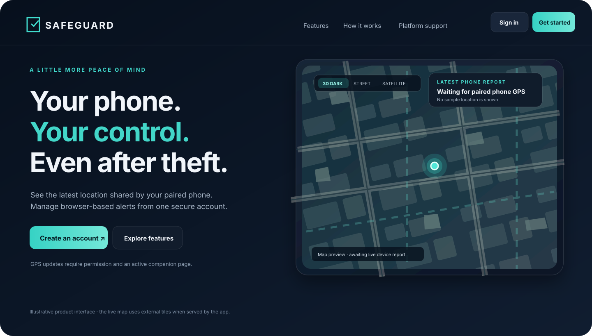
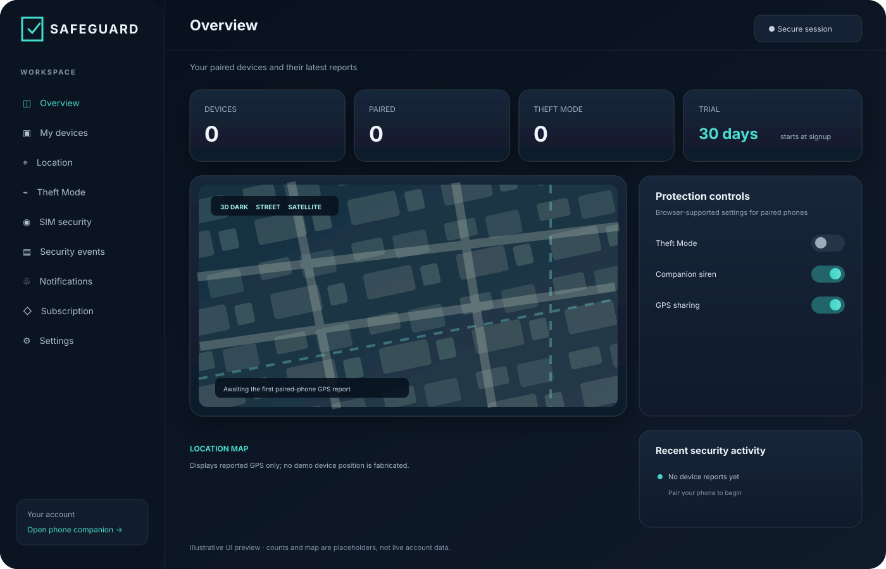
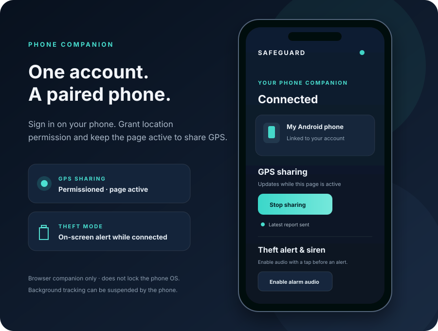

<div align="center">

# SAFEGUARD

### Permissioned phone location. Theft alerts. One clear dashboard.

SAFEGUARD pairs an account with a phone browser companion, displays the phone’s latest reported GPS location, and syncs Theft Mode alerts while the companion is active and connected.


<br>



*Illustrative interface preview. Live maps require the SAFEGUARD server and external map tiles.*

</div>

---

## Product previews

These repository images are **illustrative interface previews**, not screenshots of live customer data. The dashboard preview uses empty counts and shows no invented phone coordinates.

| Customer dashboard | Phone companion |
|---|---|
|  |  |

## What works in this release

- Customer accounts with bcrypt password hashes, signed HTTP-only account cookies, role-based customer/admin views, and an automatically started 30-day trial.
- Phone pairing by account sign-in, with a device-scoped phone token and duplicate pairing for the same browser avoided.
- Browser GPS reports sent about every three seconds while the paired companion is open, permitted, connected, and running.
- Dashboard location map with MapLibre GL JS, dark/street/satellite styles, building extrusions, and the latest received device marker.
- Theft Mode state sync, an in-page alert, and browser siren audio after the user enables audio on the phone.
- Timestamped device events, customer dashboard sections, admin overview, and a process-memory fallback when MongoDB is unavailable.

## Important capability limits

> SAFEGUARD’s phone component is currently a **browser companion**, not a native Android or iOS anti-theft app. GPS can pause when a browser is backgrounded, closed, offline, or suspended. A web page cannot lock the phone operating system, detect SIM swaps, prevent flashing or factory reset, track a powered-off phone, override silent mode, or guarantee alarms while the page is suspended.

Background tracking and operating-system controls require native apps, platform permissions, and—where supported—eligible Android Enterprise or Apple MDM enrollment. Powered-off finding is controlled by separate platform services such as Find My or Find Hub on supported, preconfigured devices. These features are not integrated in this release. See [mobile capabilities](documentation/mobile-capabilities.md).

## Run locally

### Requirements

- Node.js 20 or newer
- MongoDB at `mongodb://127.0.0.1:27017/safeguard` for persistent accounts, devices, GPS reports, and events (optional for local evaluation)

### Start the app

```powershell
npm install
$env:JWT_SECRET = "replace-with-a-random-secret-of-at-least-32-characters"
npm start
```

Keep the server process running and open **<http://127.0.0.1:4173>**. Do not open `public/index.html` directly as a `file://` URL; direct file mode cannot reach the backend, login APIs, or live map module.

If MongoDB is unavailable, the server reports `database: memory` from `/api/health` and stores data only for that process lifetime. It clears when the server stops. Use MongoDB for data you need to keep.

### Provision the first administrator

Set an administrator email and a temporary bootstrap secret before starting the server:

```powershell
$env:ADMIN_EMAILS = "admin@example.com"
$env:ADMIN_BOOTSTRAP_SECRET = "replace-with-a-different-random-secret-of-at-least-32-characters"
npm start
```

Open `/admin-setup.html`, create the first administrator, then remove `ADMIN_BOOTSTRAP_SECRET` from the server environment and restart. Public registration cannot assign the administrator role. Never commit `.env` files or real secrets.

## Pair a phone

1. Open the dashboard and create or sign in to an account.
2. Open `/phone` on the phone you own and sign in with the same account.
3. Grant location permission and keep the companion page active for GPS updates.
4. Use the dashboard’s Location and Theft Mode sections to review reports and signal an alert.

Phone GPS requires a secure context. For a real phone, serve the app through HTTPS (for example, a properly configured HTTPS tunnel or reverse proxy); `localhost` is only local to the device using it.

## Routes and API

| Route | Purpose |
|---|---|
| `/` | Product home and interactive map preview |
| `/auth.html` | Customer sign in and account creation |
| `/app.html` | Authenticated customer dashboard |
| `/admin.html` | Admin-only operations dashboard |
| `/admin-setup.html` | First administrator provisioning |
| `/phone` | Account-based phone browser companion |
| `/api/health` | Server and persistence mode status |

The service exposes account, device pairing, GPS, Theft Mode, security event, dashboard, and admin overview APIs. See the [API guide](documentation/api.md).

## Stack

| Layer | Technology |
|---|---|
| Web interface | HTML, CSS, JavaScript |
| Server | Node.js, Express 5 |
| Account security | bcrypt, signed JWT sessions, role checks, Helmet, rate limits |
| Database | MongoDB with in-memory local fallback |
| Map | MapLibre GL JS, OpenFreeMap/CARTO styles, Esri imagery option |
| Phone companion | Browser Geolocation API, device-scoped token, active-page polling |

## Vercel status

The repository is not yet linked to a Vercel project or deployed. The current app is an Express server that connects to MongoDB and starts with `npm start`; deployment needs a Vercel-compatible serverless entry point and a reachable hosted MongoDB connection. Do not deploy with the local MongoDB URL or rely on process-memory fallback for production persistence.

## Documentation

- [Local setup](documentation/setup.md)
- [Architecture](documentation/architecture.md)
- [API reference](documentation/api.md)
- [Security and privacy](documentation/security.md)
- [Mobile capability boundaries](documentation/mobile-capabilities.md)
- [Deployment notes](documentation/deployment.md)
- [Testing guide](documentation/testing.md)

## Development check

Run JavaScript syntax checks with:

```powershell
npm run check
```


